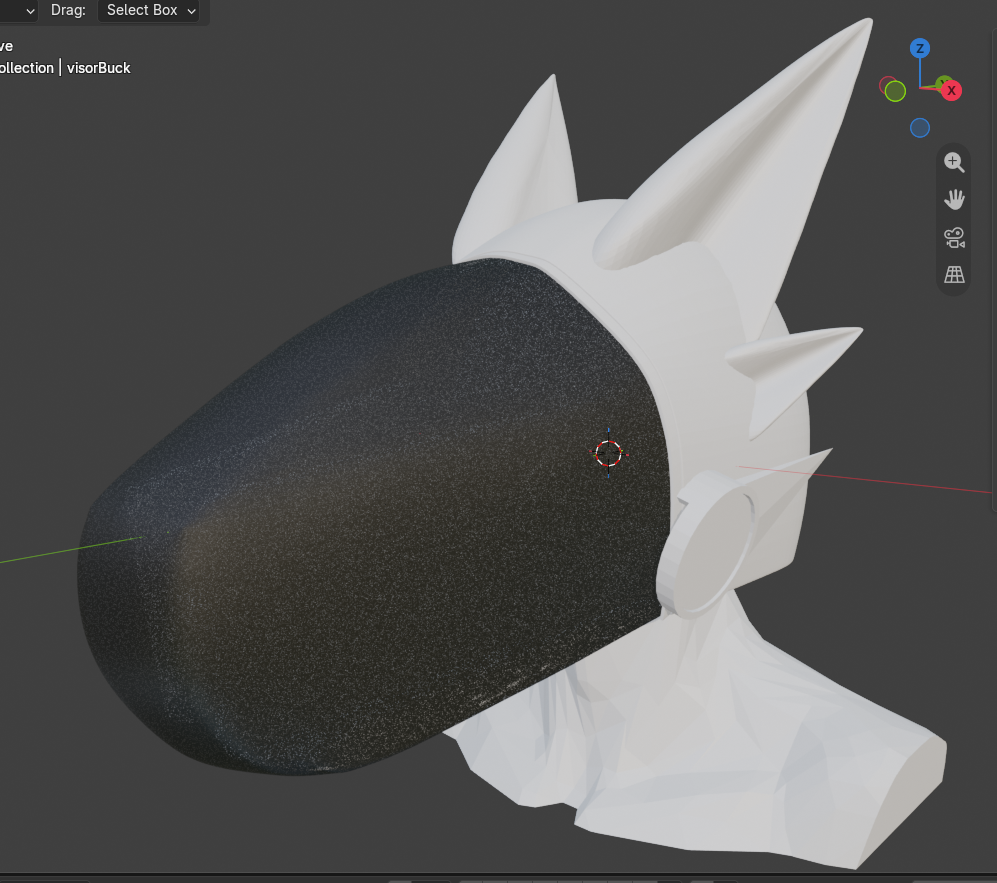
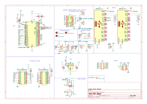
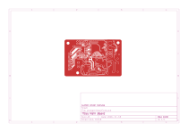
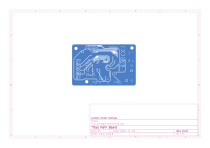
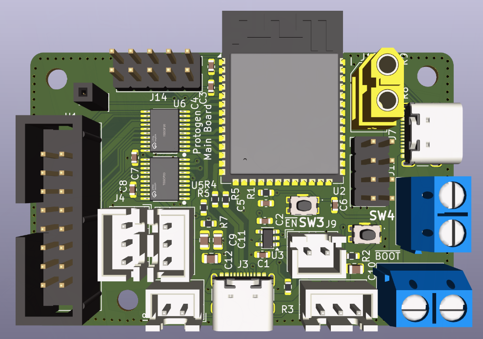
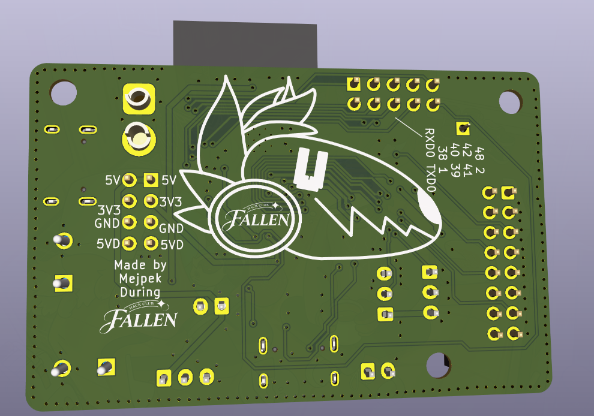
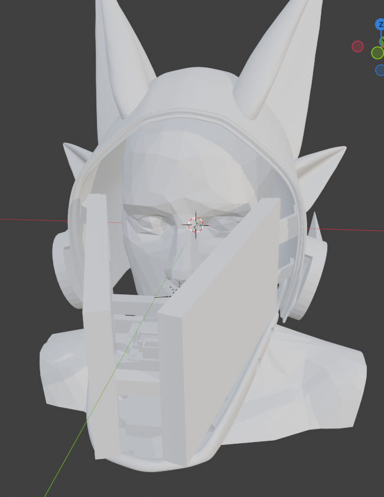

# Protogen head
  
It is a wearable protogen fursuit head that you can make at home! Just follow the readme bellow :3 I made it because I wanted to make a fursuit for a long time and I wanted to challenge my hardware skills as well as learn more about blender.
## Hardware
The PCB for this protogen head contains ESP32-S3-WROOM-1 and is powered by two USB-C ports/one USB-C port and XT-30 connector. You can connect to it:
- Two serialy connected HUB75 LED matrixes
- Two WS2812B LED strips (or any addresable LEDs)
- Two small fans
- One speaker
- One capacitive button  

It also has 10 GPIO pins exposed as well as two of each voltage pins. The +5VD net is used to power only LED Matrixes and the +5V powers the rest. ESP32 works on 3V3, so I had to use a LDO to power it. There are also two 74AHCT245PW used to change the logic voltage from 3V3 to 5V, so it can communicate with the peripherals that require 5V. The production files can be found in hardware/protogenHead/jlcpcb/production_files .  
  
 
 
 

## 3D Model
You need at least 1700g of filament to print it. I recommend using PETG or something stronger, avoid PLA because it might not be strong enough. This protogen features two pairs of ears with a pair of side panels. It can also accomodate two Waveshare 20117 screens, PCB, two fans and you can additionally make a capacitive touch sensor to detect boops. Just connect a piece of for example aluminum foil via a wire to the designated PCB pin. Remember to calibrate the threshold value by checking how it changes when touched. Everything is mounted using M3 screws, you additionally need heat inserts for the ears.
  

## Software
The source code is mainly in file software/src/main.cpp It has comments, so I will only describe here the functionality. In the future I want to add the ability to control the board over WiFi.
### LED Matrix control
The software uses ESP32-HUB75-MatrixPanel-I2S-DMA library. The pins are setup for the provided PCB so if you want to use your own, just modify it. It comes preloaded with one animation, you have to convert the bitmaps to header files that contain the pixel values. See the example files in software/src on how it looks like. Remember that the arrays have to be the size of your LED number.
### Additional LED control
You can connect two additional programmable LED strips/rings that share the same control pin. Then you just have to change the color to whatever you like in setLEDColor.
### Boop detection
You can add a capacitive sensor to the touch pin. You just have to test what values it gives back and set the threshold accordingly. I use it to play a sound using the FIT0449 speaker. Just provide a SoundData.h with the values of sound exported from Audacity or simmilar program. You can check out the example in software/src.
## How to build (will add more details after I build it)
1) Order the PCB using the gerber files provided in hardware/productionFiles
2) Order all components according to the BoM below
3) Print all the parts provided in 3D Models/print
4) Assemble the PCB and upload software using the opposite port to the ESP32
5) Vacuum form the visor (look at the tutorial provided in section vacuum forming)
6) Glue the magnets to the visor and to the bottom jaw.
7) Fur the base as you wish
8) Screw everything together with M3 screws, remember to embed heat inserts into the ears
9) Attach the visor and power everything with two USB-C cables connected to a powerbank or one USB-C cable on the port opposite to the ESP-32 and one battery connected to the XT30 connector.
## BoM [*WIP*]
### PCB
#### PCB Manufacturing

| Component | Qty | Price per item | Price |
| --------- | --- | -------------- | ----- |
| PCB | 10 | $0.5 | $5 |
| Stencil | 1 | $2.5 | $2.5 |
| Total | | | $7.5 |

#### PCB Components
| Designator | Component | Qty | Price Per Unit | Price |
| ---------- | --------- | --- | -------------- | ----- |
| C10 | [GRM219R61C226ME15L](https://www.tme.eu/pl/details/grm219r61c226me15l/) | 2 | 1.507 PLN | 3.01 PLN |
| C9, C11, C12 | [CL21A106KPFNNNG](https://www.tme.eu/pl/details/cl21a106kpfnnng/) | 10 | 0.333 PLN | 3.33 PLN |
| J1, J2 | [DG301-5.0-2P12](https://www.tme.eu/pl/details/dg301-5.0-2p12/) | 2 | 0.88 PLN | 1.76 PLN |
| C3 | [GRM188R60J106KE47D](https://www.tme.eu/pl/details/grm188r60j106ke47d/) | 10 | 0.145 PLN | 1.45 PLN |
| J8, J9 | [B2B-XH-A](https://www.tme.eu/pl/details/b2b-xh-a/) | 2 | 0.365 PLN | 0.73 PLN |
| C4, C6, C7, C8 | [CL10B104JB8NNNC](https://www.tme.eu/pl/details/cl10b104jb8nnnc/) | 10 | 0.248 PLN | 2.48 PLN |
| R4, R5 | [ERJ3EKF27R0V](https://www.tme.eu/pl/details/erj3ekf27r0v/) | 10 | 0.113 PLN | 1.13 PLN |
| R6, R7, R8, R9 | [ERJ3EKF5101V](https://www.tme.eu/pl/details/erj3ekf5101v/) | 10 | 0.079 PLN | 0.79 PLN |
| J11 | [ZL202-8G](https://www.tme.eu/pl/details/zl202-8g/) | 10 | 0.452 PLN | 4.52 PLN |
| U1 | [T821-1-16-S1](https://www.tme.eu/pl/details/t821-1-16-s1/) | 2 | 4.138 PLN | 8.28 PLN |
| J14 | [67997-410HLF](https://www.tme.eu/pl/details/67997-410hlf/) | 1 | 1.1 PLN | 1.1 PLN |
| R1, R2, R3 | [ERJ3EKF1002V](https://www.tme.eu/pl/details/erj3ekf1002v/) | 10 | 0.036 PLN | 0.36 PLN | 
| J10 | [XT30U-F](https://www.tme.eu/pl/details/xt30u-f/) | 1 | 4.45 PLN | 4.45 PLN |
| J12 | [DS1002-01-1X08V13](https://www.tme.eu/pl/details/ds1002-01-1x08v13/) | 5 | 1.349 PLN | 6.75 PLN |
| U2 | [ESP32S3-WRM1-16R8](https://www.tme.eu/pl/details/esp32s3-wrm1-16r8/) | 1 | 31.48 PLN | 31.48 PLN |
| J4, J5, J6 | [B3B-XH-A](https://www.tme.eu/pl/details/b3b-xh-a/) | 3 | 0.505 PLN | 1.52 PLN |
| U5, U6 | [74AHCT245PW.118](https://www.tme.eu/pl/details/74ahct245pw.118/) | 4 | 1.606 PLN | 6.43 PLN |
| J3, J7 | [USB4105-GF-A](https://www.tme.eu/pl/details/usb4105-gf-a/) | 3 | 3.535 PLN | 10.61 PLN |
| U3 | [AP2112K-3.3TRG1](https://www.tme.eu/pl/details/ap2112k-3.3trg1/) | 2 | 1.173 PLN | 2.35 PLN |
| C1, C2, C5 | [CC0603KRX7R8BB105](https://www.tme.eu/pl/details/cc0603krx7r8bb105/) | 10 | 0.411 PLN | 4.11 PLN |
| SW3, SW4 | [KMR221GLFS](https://www.tme.eu/pl/details/kmr221glfs/) | 3 | 2.401 PLN | 7.20 PLN |
| Pin cover | [NDR-08](https://www.tme.eu/pl/details/ndr-08/) | 10 | 0.574 PLN | 5.74 PLN |
| Pin cover | [NSR-02](https://www.tme.eu/pl/details/nsr-02/) | 20 | 0.24 PLN | 4.79 PLN |
| Total | | | | 114.35 PLN (~$28.12) |

### Other hardware 
| Component | Qty | Price per item | Price |
| --------- | --- | -------------- | ----- |
| [Waveshare 20117](https://kamami.pl/matrycowe/587574-rgb-matrix-p3-64x32-wyswietlacz-matrycowy-led-rgb-64x32-5906623465668.html) | 2 | 119.33 PLN | 238.66 PLN |
| [FIT0449](https://botland.com.pl/gravity-moduly-dzwiekowe/5501-dfrobot-gravity-glosnik-z-interfejsem-cyfrowym-6959420909575.html) | 1 | 26.90 PLN | 26.90 PLN
| [WS2812B](https://nettigo.pl/products/tasma-led-rgb-ws2812b-5v-bialy-podklad-60-m-ip67-wodoodporna) | 1 | 31 PLN | 31 PLN |
| [Sunon 1197317](https://kamami.pl/wentylatory/1197317-sunon-ee40100s2-1000u-999-5902186301221.html) | 2 | 10.20 PLN | 20.40 PLN |
| Total | | | 316.96 PLN (~$77.97)

### Other
| Component | Qty | Price per item | Price |
| --------- | --- | -------------- | ----- |
| [Creality CR-PETG black](https://botland.com.pl/filamenty-petg/23007-filament-creality-cr-petg-175mm-1kg-black-6971636405344.html) | 2 | 49 PLN | 98 PLN |
| Screws | | | |
| Materials for vacuum forming | | | |
| Fur | | | |
| [Magnets 10x4mm](https://kamami.pl/magnesy-trwale/1186637-mno-100x040-10-szt-magnes-neodymowy--5906623484065.html) | 20 | 2.793 PLN | 55.86 PLN |
| Total | | | |