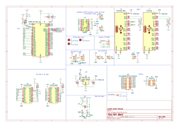
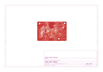
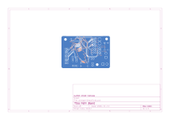
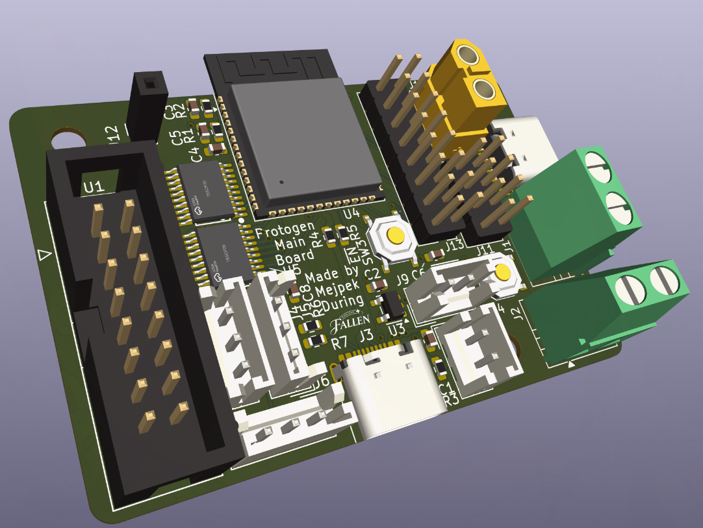
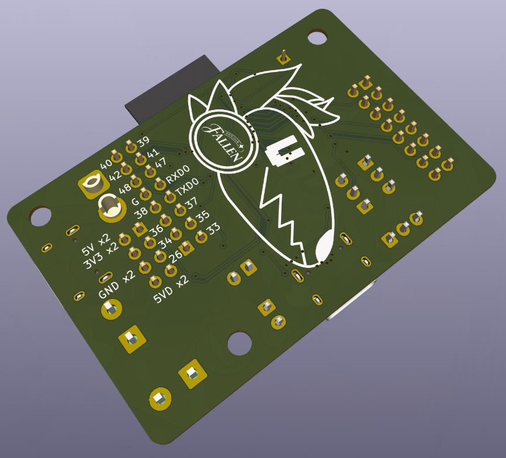

# Protogen head
**WIP**
## Hardware
The PCB for this protogen head contains ESP32-S3-Mini and is powered by two USB-C ports/one USB-C port and XT-30 connector. You can connect to it:
- Two serialy connected Waveshare 22101 (or simillar) LED matrixes
- Two WS2812B LED strips
- Two small fans
- One speaker
- One capacitive button  

It also has 15 GPIO pins exposed as well as two of each voltage pins. The +5VD net is used to power only LED Matrixes and the +5V powers the rest. ESP32 works on 3V3, so I had to use a LDO to power it. There are also two 74AHCT245PW used to change the logic voltage from 3V3 to 5V, so it can communicate with the peripherals that require 5V. The production files and LCSC BoM can be found in hardware/protogenHead/jlcpcb/production_files .  
  
 
 
 

## 3D Model
**TODO**
## Software
**TODO**