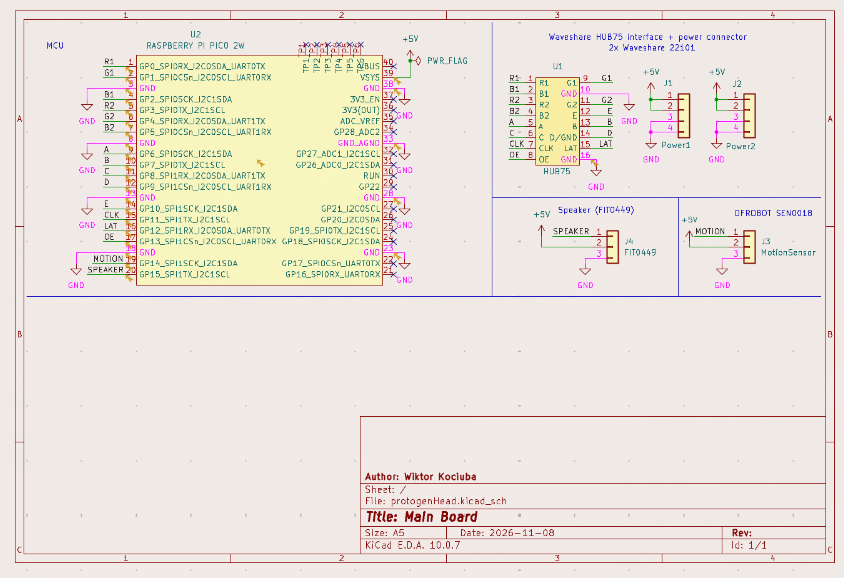

# Protogen head
WIP  
It will feature:  
- Raspberry Pi Pico 2 W
- 2x 64x32 LED Matrix (Waveshare 22101)  
- DFROBOT SEN0018 Motion Sensor (for detecting boops)
- DFROBOT FIT0449 Speaker
## Schematic
